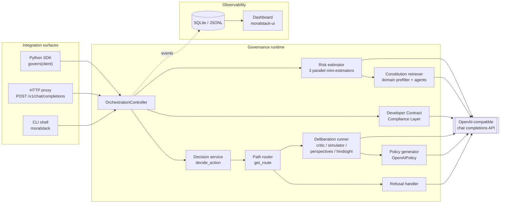
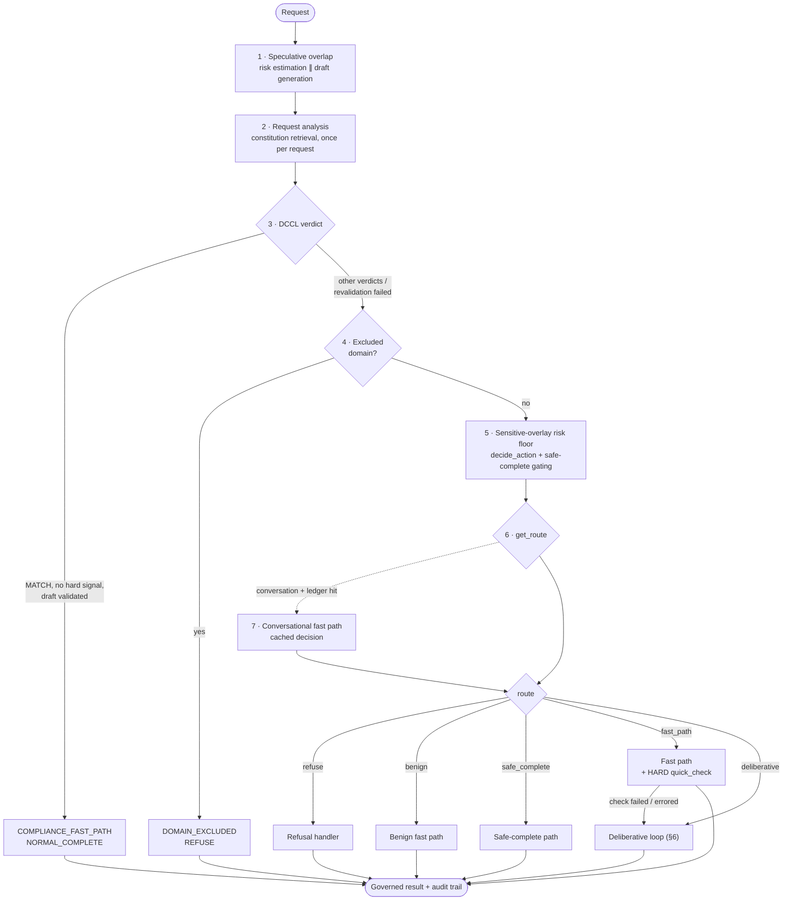
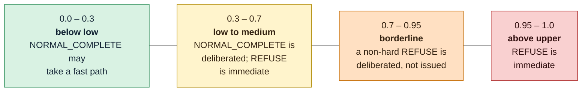
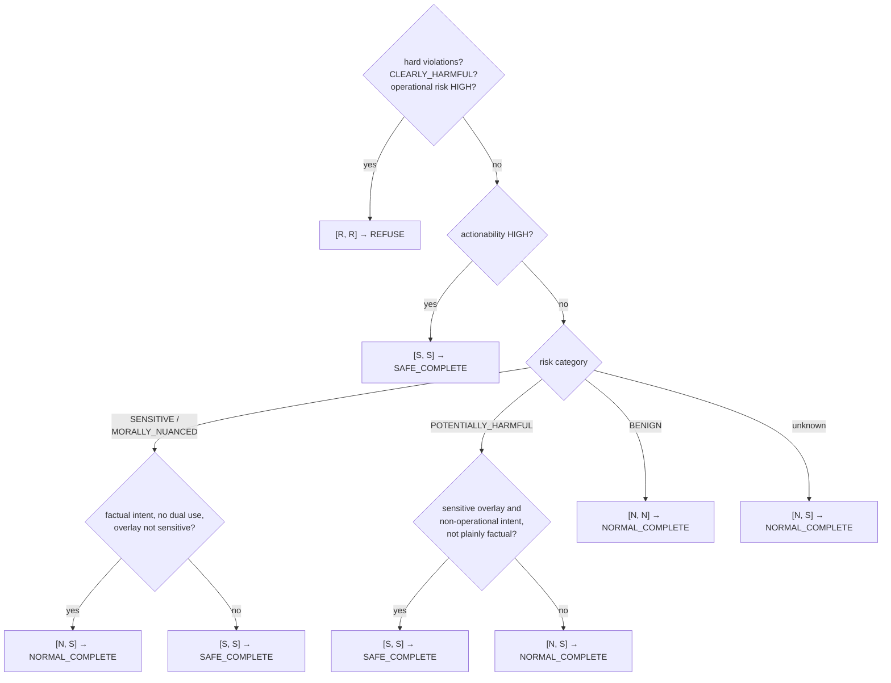
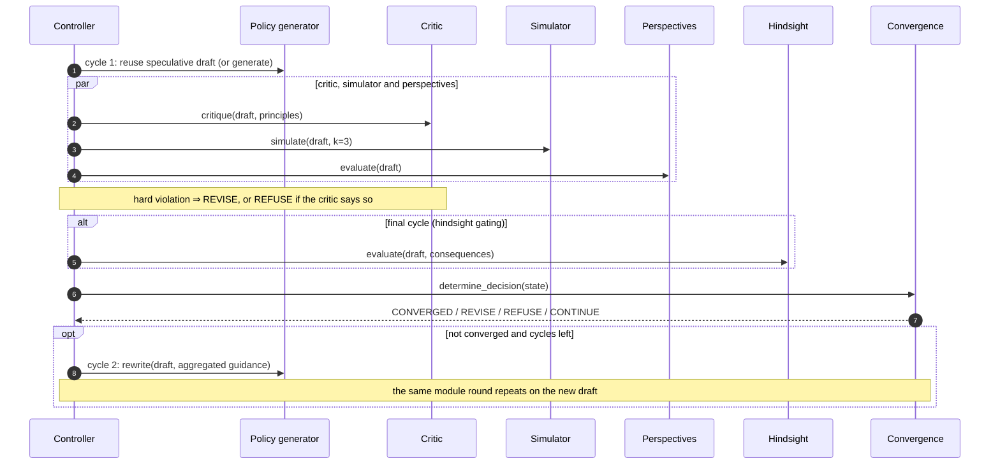
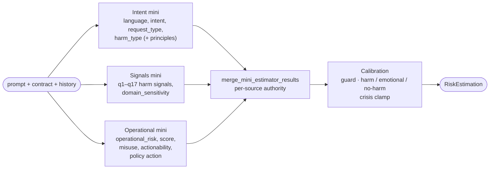
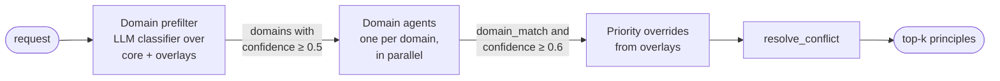
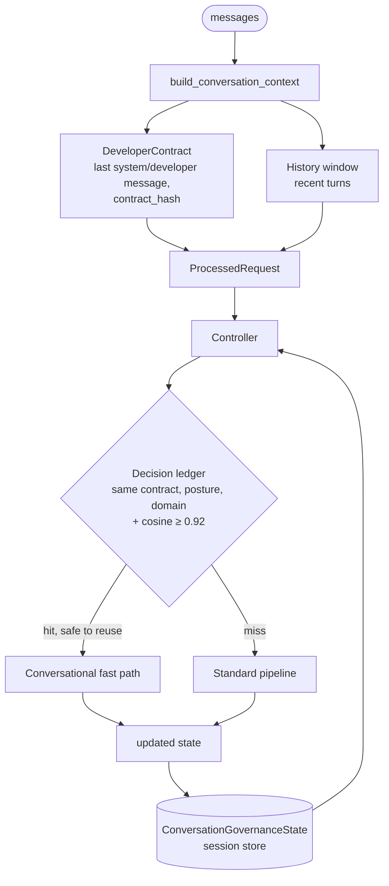
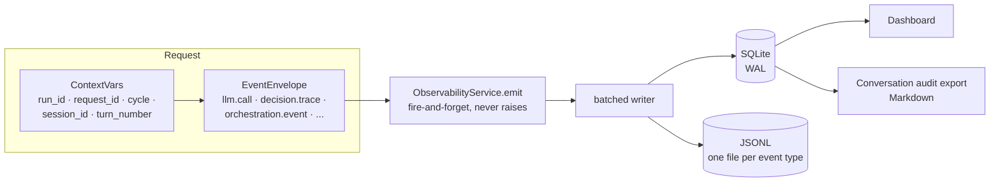

# MoralStack Architecture

> **Scope.** How MoralStack is built and why: the request lifecycle, the decision model, the cognitive
> modules, the constitution, multi-turn governance, the integration surfaces, failure handling and
> observability. Written against **MoralStack 1.0.0** and re-verified against the code on 2026-10-23.
>
> **Authority.** The code wins. This document explains the architecture; the per-module contracts live
> in [`docs/modules/`](./modules/README.md), the step-by-step traces in [`docs/traces/`](./traces/), the
> verified ledger in [`CODEBASE_FACTS.md`](./CODEBASE_FACTS.md) and the file map in
> [`MORALSTACK_CODEBASE_INDEX.md`](./MORALSTACK_CODEBASE_INDEX.md). Symbols are cited as
> `path` + function name rather than line numbers, so that the references survive edits.

---

## Contents

1. [What MoralStack is](#1-what-moralstack-is)
2. [Design principles and invariants](#2-design-principles-and-invariants)
3. [The system at a glance](#3-the-system-at-a-glance)
4. [Lifecycle of a request](#4-lifecycle-of-a-request)
5. [How `final_action` is decided](#5-how-final_action-is-decided)
6. [The deliberative loop](#6-the-deliberative-loop)
7. [Cognitive modules](#7-cognitive-modules)
8. [The constitution](#8-the-constitution)
9. [Multi-turn governance](#9-multi-turn-governance)
10. [Integration surfaces](#10-integration-surfaces)
11. [Failure handling](#11-failure-handling)
12. [Observability and audit](#12-observability-and-audit)
13. [Configuration](#13-configuration)
14. [Testing and quality gates](#14-testing-and-quality-gates)
15. [Known gaps](#15-known-gaps)
16. [Glossary](#16-glossary)

---

## 1. What MoralStack is

MoralStack is a **governance engine** that sits between an application and a large language model. Every
request goes through a pipeline that estimates its risk, retrieves the relevant ethical principles,
optionally deliberates over a draft answer, and finally commits to one of three explicit actions:

| `final_action` | Meaning | What the user receives |
|---|---|---|
| `NORMAL_COMPLETE` | The request is fine as asked | A direct answer |
| `SAFE_COMPLETE` | The request is legitimate but needs care | An answer generated *with* safeguards (framing, scope limits, safety resources) |
| `REFUSE` | The request must not be fulfilled | A governed refusal with safe redirection |

The action is a **structured decision**, not a property of the text: it is computed from typed signals
(risk category, operational risk, constitutional violations, ...) and the generator then writes *within*
the decided bounds. `SAFE_COMPLETE` in particular is a first-class policy action, not a disclaimer
appended after the fact.

Three facts shape everything else:

- **Every cognitive module is an LLM call.** Risk estimation, constitutional critique, consequence
  simulation, hindsight evaluation, perspective review and constitution retrieval all run as prompted,
  schema-constrained calls to an OpenAI-compatible chat-completions API (`moralstack/models/policy.py`,
  `OpenAIPolicy`). There are no local fine-tuned models, no reward model and no training loop in the
  runtime; the only local model is an optional embedding model used by the multi-turn decision ledger
  (§9).
- **Governance is the product, not a filter.** The delivered answer is always produced inside the governed
  pipeline (invariant 7, §2). A wrapped client is never asked to generate the answer the user sees.
- **The output is auditable by construction.** Each request leaves a decision trace, the LLM calls that
  produced it and the signals behind the action in SQLite and/or JSONL, readable through the dashboard and
  exportable as a Markdown audit trail (§12).

---

## 2. Design principles and invariants

MoralStack's behavior rests on a small set of load-bearing rules. The first column is the short name used
across the repository (the full text lives in `PROJECT_SPEC.md` §5 and in `.claude/rules/`).

| # | Invariant | What it guarantees | Where it is enforced |
|---|---|---|---|
| 1 | **Decision/generation separation** (P0) | `final_action` comes from structured signals, never from reading the response text | `runtime/decision/safe_complete_policy.py` (`compute_action_bounds`, `decide_final_action`); `orchestration/decision_service.py` (`decide_action`) |
| 2 | **System-prompt transparency** | Governance never mutates the developer's system prompt | prompt composition in `orchestration/`; `tests/test_system_prompt_byte_equality.py` |
| 3 | **Hard-signal supremacy** (P0) | Self-harm, child safety, weapons and physical-harm signals cannot be overridden by a developer contract, an overlay or a cached decision | `orchestration/path_router.py` (`has_hard_signal_evidence`, `is_hard_signal_refuse`); `compliance/safety_override.py`; ledger guard in `controller.py` |
| 4 | **Single-turn prompt transparency** | No contract and no history ⇒ prompts byte-identical to the single-turn baseline | `tests/test_system_prompt_byte_equality.py`, `tests/prompts_golden/` |
| 5 | **`core` is retrieval-only** | The `core` constitution is never used as a runtime domain overlay | `controller._normalize_runtime_domain`; risk estimator domain selection |
| 6 | **Observability never breaks the request** | Telemetry is best-effort; a logging failure cannot fail or alter a request | `observability/service.py` (`emit`), `emit_helpers.py`, SQLite sink writers |
| 7 | **Governed delivery only** | Every user-visible answer is generated inside the pipeline; a pipeline failure fails closed to a governed refusal | `orchestration/delivery.py` (`finalize_delivery`); `sdk/wrapper.py`; `server/proxy.py` |

Two engineering principles sit on top of the invariants:

- **Fail closed.** When the pipeline cannot verify a draft (critic failure, timeout, missing verdict), the
  answer is a governed `REFUSE`, never the unverified draft (§11).
- **Pay for deliberation only where it matters.** Clearly benign and clearly harmful requests take short
  paths; the full deliberative loop is reserved for sensitive or ambiguous requests, and several
  mechanisms (speculative drafting, parallel module calls, gating, caching) keep its latency bounded.

---

## 3. The system at a glance



### Package map

| Package | Responsibility |
|---|---|
| `moralstack/sdk/` | Public SDK: `govern()`, `GovernedClient`, `GovernanceConfig`, `GovernedResponse`, session store, bootstrap |
| `moralstack/server/` | OpenAI-compatible governance proxy (`create_app`), audit headers, conversation correlation |
| `moralstack/runtime/` | `Orchestrator` facade and factories; the deliberative modules (`runtime/modules/`); the decision policy (`runtime/decision/`); decision-correctness diagnostics |
| `moralstack/orchestration/` | The controller and everything it coordinates: routing, decision service, deliberation runner, convergence, refusal handling, delivery, multi-turn state, ledger, embedders |
| `moralstack/models/` | The LLM policy wrapper (`policy.py`) and the risk estimator (`models/risk/`) |
| `moralstack/constitution/` | Constitution schema, YAML data (`core.yaml` + overlays), store and retriever |
| `moralstack/compliance/` | The Developer Contract Compliance Layer (DCCL) and its safety override |
| `moralstack/prompts/` | The externalized prompt catalog (`data/*.yaml`) and its loader |
| `moralstack/observability/` | Event envelopes, context variables, sinks (SQLite, JSONL), token accounting |
| `moralstack/reports/` | Request reports and the conversation audit export |
| `moralstack/ui/` | FastAPI + Jinja dashboard |
| `moralstack/cli/` | Interactive shell and the overlay validator |
| `moralstack/utils/` | Shared helpers: provider-error classification, module result cache, output protection, structured output |

---

## 4. Lifecycle of a request

All entry points converge on `OrchestrationController.process` (`moralstack/orchestration/controller.py`).
The `Orchestrator` class in `moralstack/runtime/orchestrator.py` is a thin facade over it, and its factories
(`create_orchestrator`, `create_minimal_orchestrator`) wire the modules.

### 4.1 Input and output types

The controller receives a `ProcessedRequest` (a plain string is wrapped automatically) and returns an
`OrchestratorResult`, both defined in `moralstack/orchestration/types.py`:

| Type | Key fields |
|---|---|
| `ProcessedRequest` | `request_id`, `prompt`, `conversation_history`, `user_context`, `developer_contract`, `conversation_context`, `generation_overrides` |
| `OrchestratorResult` | `response: FinalResponse`, `path` (`FAST_PATH`, `DELIBERATIVE_PATH`, `COMPLIANCE_FAST_PATH`, `DOMAIN_EXCLUDED`, `ERROR_PATH`), `path_taken`, `total_cycles`, `converged`, `errors`, `trace`, `compliance_verdict` |
| `FinalResponse` | `content` (generated text only), `response_type`, `metadata: ResponseMetadata` |
| `ResponseMetadata` | `final_action`, `path`, `risk_score`, `hindsight_score`, `deliberation_cycles`, `triggered_principles`, `hard_violations`, `reason_codes`, `winning_rule`, `why_not_*`, `decision_correctness`, `draft_origin`, token accounting |

`ResponseMetadata` is always built through its factories (`from_decision`, `for_system_error`,
`for_domain_excluded`, `for_fail_safe`) so that every path produces consistent metadata.

### 4.2 The stages



**1 · Speculative overlap.** When `enable_speculative_generation` is on (the default), the controller starts
the risk estimation and a first draft in parallel (`_run_speculative_overlap`). It waits only for the risk
estimate; the draft is joined later if the route needs it, and abandoned if the route makes it useless
(refusals, safe-complete, constrained generation for clearly harmful requests).

**2 · Request analysis.** The constitution retrieval runs once per request, owned by the risk estimator, and
the resulting principles are shared by every downstream module (§8).

**3 · Developer Contract Compliance Layer.** When the developer supplied a system prompt, the DCCL
(`moralstack/compliance/dccl.py`) asks whether the request invokes a behavior the deployer explicitly
authorized. Verdicts are `MATCH`, `NO_MATCH`, `SAFETY_OVERRIDE` and `NO_CONTRACT`; the evaluation path is
configurable (`structured`, `llm`, `hybrid`, default `hybrid`). On `MATCH` the controller runs a small
state machine: reuse the validated speculative draft, or regenerate and revalidate it when the draft is
missing or the verdict is low-confidence; if revalidation fails the request falls back to the standard
pipeline. A successful `MATCH` routes to `COMPLIANCE_FAST_PATH` with `NORMAL_COMPLETE` and skips the
deliberative modules. A `MATCH` is **downgraded to the standard pipeline whenever the risk estimate carries
hard-signal evidence** — the contract can authorize behaviors, never override P0 signals (invariant 3).
Details: [`modules/compliance_layer.md`](./modules/compliance_layer.md).

**4 · Domain exclusion.** If the detected domain belongs to an overlay marked `excluded`, the request exits
early with `REFUSE` on path `DOMAIN_EXCLUDED`. No shipped overlay sets `excluded`; the mechanism exists for
deployer overlays.

**5 · Pre-routing decision.** Sensitive overlays impose a minimum risk score (`sensitive_risk_floor`, global
default 0.35 in `orchestration/overlay_policy.py`). The decision service then computes a first
`final_action` from the risk estimate alone (§5), and safe-complete gating may adjust it.

**6 · Routing.** `get_route` (`orchestration/path_router.py`) maps the pre-routing decision to one of five
routes, checked in this order:

| Order | Route | Condition | What happens |
|---|---|---|---|
| 1 | `refuse` | `REFUSE`, not already deliberative, **not** borderline | Refusal handler writes a governed refusal |
| 2 | `benign` | `NORMAL_COMPLETE`, operational risk `NONE`, score < `low` | Draft delivered after the benign fast path |
| 3 | `safe_complete` | `SAFE_COMPLETE`, not already deliberative | Answer regenerated under safe-complete guidance, 0 cycles |
| 4 | `fast_path` | `NORMAL_COMPLETE`, policy action `ALLOW`, score < `low` | Draft checked by the critic's HARD-only `quick_check`; any failure escalates to deliberation |
| 5 | `deliberative` | everything else | Full deliberative loop (§6) |

A `REFUSE` is **borderline** when the score is in `[medium, borderline_refuse_upper]` and the refusal is not
anchored by hard evidence (hard violations, non-overridable reason codes or hard semantic signals). Borderline
refusals are not issued immediately: they go through deliberation, which may confirm them or soften them.

The thresholds are `RiskThresholds(low=0.3, medium=0.7)` and `borderline_refuse_upper=0.95`
(`OrchestratorConfig`, overridable through `MORALSTACK_ORCHESTRATOR_*`). For routing only, the router
re-derives the risk-policy action from operational risk (`HIGH → DENY`, `NONE → ALLOW`, `LOW → DELIBERATE`);
the authoritative decision stays in the decision service.



The bands are not routes by themselves — the route also depends on the pre-routing decision and on the
operational risk — but they summarize how the score is read. A `SAFE_COMPLETE` takes the safe-complete
route in every band, and a `REFUSE` anchored by hard evidence is immediate at any score.

**7 · Conversational fast path.** In a conversation with a decision ledger (§9), a sufficiently similar
earlier turn under the same contract, posture and domain can supply a cached decision and force its route,
skipping deliberation. A cached non-refusal is **never** reused when the current turn carries hard-signal
evidence.

### 4.3 Which modules run on which path

| Path | Risk estimator | Retrieval | Draft | Critic | Simulator | Perspectives | Hindsight | Refusal generator |
|---|---|---|---|---|---|---|---|---|
| `COMPLIANCE_FAST_PATH` | ✓ | ✓ | ✓ (DCCL-validated) | – | – | – | – | – |
| `DOMAIN_EXCLUDED` | ✓ | ✓ | – | – | – | – | – | – |
| refuse route | ✓ | ✓ | abandoned | – | – | – | – | ✓ |
| benign fast path | ✓ | ✓ | ✓ | – | – | – | – | – |
| safe-complete path | ✓ | ✓ | regenerated | – | – | – | – | – |
| fast path | ✓ | ✓ | ✓ | HARD `quick_check` | – | – | – | – |
| deliberative path | ✓ | ✓ | ✓ / rewrite | ✓ every cycle | ✓ (gating opt-in) | ✓ every cycle | final cycle only (default) | if the outcome is `REFUSE` |

---

## 5. How `final_action` is decided

### 5.1 Action bounds

The decision model treats the three actions as an ordered scale, **`NORMAL_COMPLETE < SAFE_COMPLETE < REFUSE`**
(N < S < R). `compute_action_bounds` (`runtime/decision/safe_complete_policy.py`) reads a `PolicyContext` of
structured inputs only — risk category, operational risk, hard-violation count, intent axes, intent type,
whether the active overlay is sensitive — and returns a minimum required and a maximum allowed action. The
rules form a ladder; the first one that matches wins:



`decide_final_action` returns the **minimum required** action together with the reason codes
(`hard_violations`, `risk_clearly_harmful`, `safe_complete_required`, `domain_regulated`, ...). In the gray
zone `[N, S]` it deliberately starts from `NORMAL_COMPLETE` to limit over-refusal; the decision service and,
where routed, the deliberative loop may still raise it. The same module is the single source of truth for
the SDK, the proxy, the CLI and the benchmarks.

### 5.2 The decision service

`decide_action` (`orchestration/decision_service.py`) starts from those bounds and applies a fixed chain of
handlers. It runs twice: once before routing (risk estimate only) and again after deliberation (with critic,
simulator and hindsight results).

| Step | Handler | Rule (summary) |
|---|---|---|
| 1 | `_handle_hard_violations` | Hard violation ⇒ `REFUSE`, except crisis support (⇒ `SAFE_COMPLETE`) and a narrow regulated-information carve-out at low risk |
| 2 | hindsight refusal | A hindsight `REFUSE` recommendation is honored |
| 3 | `_handle_normative_refuse_guards` | Operational risk `HIGH`, or misuse `HIGH` with actionability `HIGH` ⇒ `REFUSE` |
| 4 | epistemic escalation | Strongly negative expected valence with high actionability ⇒ `SAFE_COMPLETE` |
| 5 | informational recovery | Restores a lighter action for clearly informational requests where the guards allow it |
| 6 | policy-bounds fallback | Otherwise, the action chosen by `decide_final_action` |

### 5.3 Post-deliberation guards

After the loop, the controller (`_route_deliberative`) applies, in order:

1. `decide_action` again, on the full deliberation state, with the path forced to `DELIBERATIVE_PATH`;
2. `evaluate_deliberation_override` — a `REFUSE` becomes `SAFE_COMPLETE` only when all modules agree the
   answer is acceptable;
3. on `CYCLES_EXHAUSTED` in a sensitive context, `NORMAL_COMPLETE` is raised to `SAFE_COMPLETE`;
4. `apply_safe_complete_gating` (`orchestration/safe_complete_gating.py`);
5. `enforce_verified_draft_delivery` — a draft without a completed critique is never delivered (⇒ `REFUSE`);
6. `enforce_no_rejected_draft_delivery` — a draft the critic rejected for a hard violation is never
   delivered (⇒ `REFUSE`).

The outcome is explained by a `DecisionExplanation` (`models/decision_explanation.py`: winning rule, reason
codes, activated signals, `why_not_*` fields) and checked, without any LLM call, by the decision-correctness
diagnostics (`runtime/decision_correctness.py`), which label it `OK`, `UNDERBLOCK`, `OVERBLOCK` or
`SYSTEM_ERROR` against the computed bounds. Full policy: [`decision_policy.md`](./decision_policy.md).

---

## 6. The deliberative loop

The loop lives in `orchestration/deliberation_runner.py`. Its job is to turn a draft into an answer that the
critic, the simulator, the perspectives and hindsight can all accept — or to establish that no acceptable
answer exists.



### 6.1 Cycle budget

| Setting | Default | Notes |
|---|---|---|
| `max_deliberation_cycles` | 2 | Upper bound for sensitive or ambiguous requests |
| effective cycles | 1 | When score < `low` and the category is neither sensitive nor morally nuanced (`_effective_max_cycles`) |
| constrained generation | 1 | For `CLEARLY_HARMFUL` requests that still reach the loop |
| soft revision | +1 rewrite | When the outcome is `CONVERGED_WITH_SUGGESTIONS` and `enable_soft_revision` is on |

`enforce_convergence_invariants` (`orchestration/convergence.py`) is the only authority that stops the loop:
`CONVERGED`, `HARD_VIOLATION_STOP` or `CYCLES_EXHAUSTED`.

### 6.2 Parallelism and gating

The critic, the simulator and the perspectives run in parallel (`parallel_module_calls=True`). A dynamic
scheduler (`_select_parallel_strategy`) decides per cycle how much to trust that parallelism:

| Strategy | Chosen when | Effect |
|---|---|---|
| `critic_gated` | a prior hard violation, intent to harm, operational risk `HIGH`, policy action `DENY`, a potentially or clearly harmful category, or requested instructions in a sensitive posture | The critic runs first; the other modules wait for its verdict |
| `full_parallel` | otherwise | All three modules start together |

Gating reduces work further:

- **Hindsight gating** (on by default): hindsight runs only in the final cycle.
- **Simulator gating** (opt-in): the simulator always runs in cycle 1 and may be skipped later only when the
  prior harm was low and the draft barely changed.

### 6.3 Convergence

`ConvergenceEvaluator.determine_decision` (`orchestration/convergence_evaluator.py`) combines the module
outputs as votes:

| Source | Vote |
|---|---|
| Critic | any violation ⇒ revise; a hard violation short-circuits to `REVISE`/`REFUSE` |
| Simulator | expected valence ≥ 0.3 ⇒ proceed, else revise; semantic expected harm ≥ 0.4, ≥ 0.6 and severe harm types (physical, self-harm, ...) add extra revise votes |
| Perspectives | the ensemble recommendation (proceed / revise / refuse) |
| Hindsight | the aggregated recommendation (proceed / revise / refuse) |

A refuse majority yields `REFUSE`; more revise than proceed votes yields `REVISE`. Convergence happens on
early cycle-1 agreement (weighted approval ≥ 0.78, every perspective ≥ 0.70, semantic harm ≤ 0.35, never when
risk ≥ `medium`), from cycle 2 on a clean critique with weighted approval ≥ 0.85, or when the hindsight score
reaches `min_hindsight_score` (0.8). Otherwise the loop continues.

### 6.4 Revision

From cycle 2 the draft is revised by `OpenAIPolicy.rewrite` with guidance built by
`build_aggregated_guidance` (`orchestration/guidance_builder.py`), which by default filters out marginal
signals; when nothing substantive remains the rewrite is skipped. The rewrite can run on a different model
(`MORALSTACK_POLICY_REWRITE_MODEL`); the shipped template sets it equal to `OPENAI_MODEL`, so no downgrade
happens unless a deployer opts in. Rewrite prompts forbid adding new examples or operational detail: a
revision restructures and reframes, it does not expand.

---

## 7. Cognitive modules

| Module | Main class | Question it answers | Output | Model setting | On failure |
|---|---|---|---|---|---|
| Risk estimator | `LLMBasedRiskEstimator` (`models/risk/estimator.py`) | How risky is this request, and why? | `RiskEstimation` | `MORALSTACK_RISK_MODEL` (+ per-mini overrides) | Fails closed to score 0.6, `SENSITIVE`, `DELIBERATE` |
| Constitutional critic | `LLMConstitutionalCritic` (`runtime/modules/critic_module.py`) | Does this draft violate a principle? | `CriticReport` | `MORALSTACK_CRITIC_MODEL` | **Fails closed**: no completed critique ⇒ no delivery |
| Consequence simulator | `LLMConsequenceSimulator` (`runtime/modules/simulator_module.py`) | What could plausibly happen if this answer is used? | `SimulationResult` | `MORALSTACK_SIMULATOR_MODEL` | Soft: error recorded, module skipped |
| Hindsight evaluator | `LLMHindsightEvaluator` (`runtime/modules/hindsight_module.py`) | Looking back at those outcomes, was the answer good? | `AggregatedHindsight` | `MORALSTACK_HINDSIGHT_MODEL` | Soft |
| Perspective ensemble | `LLMPerspectiveEnsemble` (`runtime/modules/perspective_module.py`) | How would different stakeholders judge it? | `EnsembleResult` | `MORALSTACK_PERSPECTIVES_MODEL` | Soft |
| Policy generator | `OpenAIPolicy` (`models/policy.py`) | Write / revise the answer | `GenerationResult` | `OPENAI_MODEL`, `MORALSTACK_POLICY_REWRITE_MODEL` | Transient errors retried; persistent failure ⇒ governed refusal |
| Refusal generator | `generate_llm_safe_refusal_detailed` (`orchestration/safe_refusal_generator.py`) | Write a refusal that redirects safely | text | primary model | Static fallback text |

Every module model falls back to the primary `OPENAI_MODEL` (default `gpt-4o`) when its own variable is unset
(`pipeline/deliberation_stack.py`, `build_deliberation_modules`).

### 7.1 Risk estimator

The estimator splits the question into three narrower ones and asks them in parallel, each with a strict JSON
schema:



- **Signals.** The seventeen harm signals (q1–q17, e.g. `Q5:physical_harm`, `Q8:self_harm_suicide`,
  `Q10:weapons_explosives_toxins`, `Q17:minor_exploitation`) are defined in `models/risk/config/signals.yaml`,
  the single source of truth for labels, priorities and effects. Eight of them are *hard semantic signals*
  for routing (`path_router._HARD_SEMANTIC_SIGNALS`). See [`q_signals_catalog.md`](./q_signals_catalog.md).
- **Calibration** (`models/risk/calibration.py`) keeps the estimator from over-reacting: benign request types
  with no intent to harm and no requested instructions are capped (risk ≤ 0.45, `HIGH → LOW` operational
  risk, `DENY → DELIBERATE`), while q17 bypasses the guard. A crisis clamp turns self-harm language without
  a request for instructions into `crisis_support`, routed to deliberation with a mid-range score.
- **Output.** `RiskEstimation` (`models/risk/schema.py`) carries the score, confidence, `risk_category`
  (`BENIGN`, `MORALLY_NUANCED`, `SENSITIVE`, `POTENTIALLY_HARMFUL`, `CLEARLY_HARMFUL`), `operational_risk`
  (`NONE`/`LOW`/`HIGH`), `risk_policy_action` (`ALLOW`, `ALLOW_WITH_CAVEAT`, `DELIBERATE`, `DENY`), the intent
  axes, the semantic signals, the detected language and domain, and the retrieved principles.

Details: [`modules/risk_estimator.md`](./modules/risk_estimator.md).

### 7.2 Constitutional critic

The critic is the only producer of `violated_hard`, which makes it governance-critical. `critique` evaluates a
draft against the retrieved principles; `quick_check` is the fast-path variant restricted to HARD principles.
Violations below severity 0.15 are dropped and hard violations get a severity floor of 0.5. The decision is
`PROCEED`, `REVISE` or `REFUSE`. A soft-only `REVISE` on a single enumerated answer (e.g. `TRUE`/`FALSE`) is
downgraded to `PROCEED`; hard violations are never affected.

Failure semantics are deliberately strict: a parse failure after all retries raises instead of guessing, a
missing HARD verdict is never treated as a pass, and the runner records each critique as `completed`,
`skipped`, `failed` or `timeout` so that the delivery guards (§5.3) can refuse anything unverified.
Details: [`modules/critic.md`](./modules/critic.md).

### 7.3 Consequence simulator

The simulator generates `k` plausible scenarios (default 3, clamped to 1–10) of what happens if the answer is
used, each typed (`immediate_harm`, `downstream_misuse`, `social_impact`, `legal_consequence`,
`positive_outcome`) and scored for valence, likelihood, harm type, severity, scope and reversibility. The
aggregate `SimulationResult` exposes the likelihood-weighted expected valence and the
`semantic_expected_harm` (maximum of likelihood × severity), which feed both convergence and the decision
service. Details: [`modules/simulator.md`](./modules/simulator.md).

### 7.4 Hindsight evaluator

Hindsight is an LLM rubric judge, not a reward model. For each simulated consequence it scores the answer on
safety, helpfulness and honesty in `[-1, 1]` and combines them with weights 0.5 / 0.3 / 0.2. Aggregation yields
`expected_value`, worst and best case, variance and a recommendation: `PROCEED` when the expected value is
non-negative, `REVISE` down to the refuse threshold (−0.7), `REFUSE` below it. Several consequences are scored
in one batched call. Details: [`modules/hindsight.md`](./modules/hindsight.md).

### 7.5 Perspective ensemble

Five perspectives are defined, with aggregation weights:

| Perspective | Weight | Used by the default runtime |
|---|---|---|
| `user` — direct user | 1.0 | ✓ |
| `compliance` — compliance reviewer | 1.0 | ✓ |
| `vulnerable` — vulnerable user | 1.2 | – |
| `observer` — neutral observer | 1.0 | – |
| `adversary` — potential misuser | 0.8 | – |

The deliberation stack builds the ensemble with `create_minimal_ensemble`, which runs only `user` and
`compliance`, in parallel. The aggregate is a weighted mean approval plus min, max and dissent; the
recommendation is `refuse` when any perspective is ≤ 0.2, `revise` when one is < 0.3 or the weighted mean is
below 0.7, otherwise `proceed`. When the critic reports a hard violation, the weighted approval is capped at
0.2 (`apply_constitutional_override`). Details: [`modules/perspectives.md`](./modules/perspectives.md).

### 7.6 Policy generator and prompts

`OpenAIPolicy` wraps the chat-completions API: `generate` / `generate_messages` for drafts, `rewrite` for
revisions (which passes the current draft as a predicted output). It retries transient provider errors,
downgrades a strict `json_schema` response format to `json_object` on models that do not support it, and, in
proxy pass-through mode, omits sampling parameters the client did not set.

All prompt text lives in an externalized catalog (`moralstack/prompts/data/*.yaml`: `common`, `compliance`,
`context`, `critic`, `hindsight`, `perspectives`, `policy`, `refusal`, `retrieval`, `risk`, `simulator`). A
deployer can replace it with `GovernanceConfig.prompts_dir` or `MORALSTACK_PROMPTS_DIR`. Overriding a
safety-relevant fragment is allowed but audited (one warning per fragment, listed in the run's prompt
configuration); it changes what the models are told, never the code-level gates. Details:
[`prompt_overrides.md`](./prompt_overrides.md).

---

## 8. The constitution

The constitution is a set of YAML principles: a `core` set and domain overlays
(`moralstack/constitution/data/`).

| Asset | Content |
|---|---|
| `core.yaml` | 35 principles — 15 hard, 20 soft. `CORE.BALANCE.1` is mandatory: loading fails without it |
| `overlays/` | 21 domains: children, coding, creative, customer_service, cybersecurity, education, emergency, enterprise, environment, financial, gaming, healthcare, journalism, legal, medical, mental_health, political, relationships, research, science, violent_crime — 13 of them flagged `sensitive` |

A `Principle` has an `id`, a `level` (`hard` or `soft`), a `priority` (1–100), a `title`, a `rule`, a few
allow/deny examples and an optional `domain`. An `Overlay` adds principles and priority overrides, plus
runtime policy: `sensitive`, `excluded`, `sensitive_risk_floor`, refusal redirection and simulator guidance.
Authoring guide: [`creating_overlays.md`](./creating_overlays.md); content and origins:
[`constitution.md`](./constitution.md).

### 8.1 Retrieval

Retrieval uses LLM classification, not embeddings (`constitution/retriever.py`, `ConstitutionRetriever.retrieve`):



Queries shorter than ten characters skip the prefilter; with no usable domains the retriever falls back to the
core principles sorted by priority. The prefilter, the agents and the store keep in-process caches.

### 8.2 Conflict resolution

`resolve_conflict` (`constitution/helpers.py`) orders principles deterministically: **hard before soft**, then
higher priority, then the more specific principle, then the id as a final tie-breaker.

### 8.3 `core` versus runtime domain

The `core` set is always a retrieval source but never a runtime overlay: the controller and the estimator both
map a detected `core` domain to "no overlay" (invariant 5). The runtime domain therefore always names a real
overlay, whose policy (sensitivity, floor, exclusion) can apply.

---

## 9. Multi-turn governance

A conversation adds two kinds of context: the developer's system prompt and the previous turns. MoralStack
treats both as governance inputs without ever rewriting them.



| Concept | Where | Role |
|---|---|---|
| `DeveloperContract` | `orchestration/contract.py` | The deployer's system prompt as a typed object; `contract_hash = sha256(raw_text\|mode)[:16]`. Built in `opaque` mode from the last non-empty system/developer message |
| `ConversationGovernanceState` | `orchestration/conversation_state.py` | Frozen per-conversation state: turn index, active domain/overlay, language, last risk posture, principle shortlist, governance posture (`NORMAL`, `ELEVATED`, `ESCALATED`), contract hash, decision summaries; `should_full_refresh` decides when to recompute everything |
| `SemanticDecisionLedger` | `orchestration/ledger.py` | Caches **decisions, never content**. Exact scope key `(contract_hash, posture, domain)`, then cosine similarity ≥ 0.92. Disabled on the first turn and under `ESCALATED` posture; checks for intent divergence |
| Embedder | `orchestration/embedder.py` | Default local `BAAI/bge-small-en-v1.5` (fastembed, optional extra) with a hashing fallback; opt-in OpenAI `text-embedding-3-small` |
| Context fingerprint | `utils/cache.py`, `build_context_fingerprint` | Adds contract hash, recent-history digest and prompt-set tag to module cache keys, so a cached simulator/hindsight/perspective result never leaks across contexts |
| Turn index | `server/proxy.py` | Derived statelessly as the number of user messages minus one |

Invariant 4 guarantees the cost of all this is zero for single-turn traffic: with no contract and no history,
the prompts are byte-identical to the single-turn baseline. Trace:
[`traces/openai_compatible_multiturn.md`](./traces/openai_compatible_multiturn.md); design notes:
[`multiturn_design.md`](./multiturn_design.md).

---

## 10. Integration surfaces

### 10.1 Python SDK

```python
from openai import OpenAI
from moralstack import govern

client = govern(OpenAI())
response = client.chat.completions.create(
    model="gpt-4o",
    messages=[{"role": "user", "content": "How do I store medication safely at home?"}],
)
print(response.content)
print(response.governance_metadata.final_action, response.governance_metadata.risk_score)
```

`govern(client, config=None)` (`sdk/wrapper.py`) returns a `GovernedClient` that intercepts
`chat.completions.create()` and passes every other attribute through to the wrapped client. Each client has a
session-scoped observability run. `create()` returns a `GovernedResponse` (OpenAI-like `choices`, `usage`,
plus `governance_metadata`), or, when `stream=True`, a governed stream that replays the governed text — live
upstream tokens are never forwarded. `GovernanceConfig` (`sdk/config.py`) sets the API key, model, base URL,
forced domain overlay, prompt directory, session tracking and ledger parameters.

### 10.2 Governed delivery

`finalize_delivery` (`orchestration/delivery.py`) is the single place that turns an `OrchestratorResult` into
the text the user receives (`GovernedDelivery`: text, source, final action, finish reason). The wrapped
client never generates a delivered answer; the deprecated `failure_policy="passthrough"` is mapped to
`"refuse"`. The one opt-in variation, `generation="upstream_then_verify"`, lets the client's model write the
*speculative draft*, which then goes through the same governance as any other draft.

### 10.3 OpenAI-compatible proxy

`create_app(openai_client=..., orchestrator=..., config=None, session_store=None, correlation_store=None)`
(`server/proxy.py`) returns a FastAPI app, so any OpenAI-compatible client (LangChain, AutoGen, evaluation
harnesses) can be governed by changing its base URL.

| Endpoint | Behavior |
|---|---|
| `POST /v1/chat/completions`, `POST /chat/completions` | Governed completion; invalid `messages` ⇒ 400; streaming is a synthetic SSE replay; pipeline failure ⇒ governed refusal with `finish_reason="content_filter"` |
| `GET /healthz` | `{status, run_id}` |

| Response header | Content |
|---|---|
| `X-Moralstack-Decision` | The delivered action |
| `X-Moralstack-Risk-Score` | Risk score (4 decimals) |
| `X-Moralstack-Posture` | Governance posture |
| `X-Moralstack-Path` | Decision path |
| `X-Moralstack-Conversation-Id` | Resolved conversation id |
| `X-Moralstack-Internal-Draft-Reused` | Whether the speculative draft was delivered |
| conditional | `-Cached-From`, `-Draft-Origin`, `-Draft-Model`, `-Compliance-Decision`, `-Compliance-Rule` |

Conversations are identified by the `X-Moralstack-Conversation-Id` header, then
`extra_body.moralstack_conversation_id`, then a correlation store keyed by principal and history hash (the
principal comes from `X-Moralstack-Tenant-Id` or an HMAC of the bearer token). Requests in the same
conversation are serialized by a per-conversation lock (30 s, then 503 with `Retry-After`). Session and
correlation stores are in-process by default, so the reference launcher (from a source checkout; `examples/` is not packaged) runs a single worker:
`uvicorn examples.server_quickstart:app --port 8080`. Contract: [`modules/server_proxy.md`](./modules/server_proxy.md).

### 10.4 Command-line tools

| Command | Purpose |
|---|---|
| `moralstack` | Interactive governed shell (`--mock`, `--minimal`, ...) |
| `moralstack-ui` | Observability dashboard (§12) |
| `moralstack-validate-overlay <path>` | Validates an overlay YAML |

Examples for every surface live in `examples/` (SDK quickstart, forced overlay, domain detection, multi-turn,
jailbreak resistance, audit trail, proxy).

---

## 11. Failure handling

MoralStack's rule is that an error may cost an answer, never safety: when something breaks, the result is a
governed refusal with a machine-readable reason.

| Failure | Detected in | Outcome |
|---|---|---|
| Risk estimator has no policy / cannot run | `LLMBasedRiskEstimator` | Fail-closed estimate (0.6, `SENSITIVE`, `DELIBERATE`) ⇒ deliberation |
| Fast-path `quick_check` fails, errors or has no constitution | `run_fast_path` | Escalates to the deliberative path; if that fails too ⇒ `REFUSE` |
| Critique failed, timed out or never completed | `enforce_verified_draft_delivery` | `REFUSE` |
| Draft rejected for a hard violation | `enforce_no_rejected_draft_delivery` | `REFUSE` |
| Simulator / hindsight / perspectives error | deliberation runner | Recorded in `errors`, module skipped, loop continues |
| Deliberation budget at 90% / 95% of `timeout_ms` | deliberation runner | Critique not attempted (⇒ fail closed) / optional modules skipped |
| `OrchestratorTimeoutError`, `MoralStackError` | `controller.process` | `REFUSE` on `ERROR_PATH`, content `[SYSTEM_TIMEOUT]` / `[SYSTEM_ERROR]`, reason `system_timeout` / `system_error`, never cached |
| Any other exception | `controller.process` | `FinalResponse.safe_default()`: `REFUSE`, principle `SYSTEM.FAIL_SAFE` |
| Proxy pipeline failure | `server/proxy.py` | Synthetic refusal, `finish_reason="content_filter"` |

The whole-request budget is `timeout_ms=600000` (10 minutes), enforced in the deliberative loop. Provider
errors are classified by `utils/provider_errors.classify_provider_error`: HTTP 429/502/503/504, rate limits,
timeouts and connection errors are **transient** and retried with jittered exponential backoff (up to
`OPENAI_MAX_RETRIES=3`, capped at 60 s); everything else, including unknown errors, is **fatal**.

---

## 12. Observability and audit



- **Envelopes.** Every event is an `EventEnvelope` (`observability/events.py`) with ids, timestamp, run,
  request, cycle, session, turn, audit level and payload. Event types cover runs, requests, LLM calls,
  orchestration events, decision traces, conversation state, ledger lookups/stores, session-store access,
  proxy finalization and token usage.
- **Sinks.** `MORALSTACK_OBSERVABILITY_MODE` selects `db_only`, `file_only` or `dual`. SQLite tables include
  `runs`, `requests`, `llm_calls`, `orchestration_events`, `decision_traces`, `conversation_states`,
  `ledger_events`, `proxy_request_events` and `request_token_usage`; JSONL writes
  `{jsonl_dir}/{event_type}.jsonl`.
- **Best effort.** Emission, persistence helpers and sink writers swallow their own exceptions (invariant 6);
  the SDK flushes synchronously before returning, and the proxy drains its queue on shutdown.
- **Token accounting.** Billable LLM calls are accumulated per request
  (`observability/request_token_accumulator.py`) and persisted in `request_token_usage`; the SDK exposes the
  totals in `GovernanceMetadata` together with a `usage_may_be_incomplete` flag.
- **Dashboard.** `moralstack-ui` (FastAPI + Jinja, form login, default port 8765) reads the SQLite database
  and shows runs, requests (decision, signals, deliberation, LLM calls, final response) and conversations,
  with Markdown exports. File-only runs do not appear.
- **Audit export.** `reports/conversation_export.py` renders the full audit trail of a conversation as
  Markdown, designed for record-keeping duties such as EU AI Act art. 12.

Schema and flow: [`modules/observability.md`](./modules/observability.md),
[`traces/observability_db_to_ui.md`](./traces/observability_db_to_ui.md).

---

## 13. Configuration

There is no configuration file: everything is read from environment variables, with `.env.template` as the
documented starting point (a non-empty `.env` value overrides the existing environment). Module configs
(`RiskEstimatorConfig`, `CriticConfig`, `SimulatorConfig`, `HindsightConfig`, `EnsembleConfig`,
`OrchestratorConfig`) can also be passed programmatically.

| Group | Prefix / variables | Highlights |
|---|---|---|
| Provider | `OPENAI_API_KEY`, `OPENAI_MODEL`, `OPENAI_BASE_URL`, `OPENAI_TIMEOUT_MS`, `OPENAI_MAX_RETRIES`, `OPENAI_TEMPERATURE`, `OPENAI_TOP_P`, `OPENAI_MAX_TOKENS` | Code defaults: `gpt-4o`, 60 s, 3 retries, temperature 0.7, top-p 0.9, 4096 tokens (the template sets temperature and top-p to 1) |
| Module models | `MORALSTACK_POLICY_REWRITE_MODEL`, `MORALSTACK_{RISK,CRITIC,SIMULATOR,HINDSIGHT,PERSPECTIVES}_MODEL`, `MORALSTACK_RISK_{INTENT,SIGNALS,OPERATIONAL}_MODEL` | Unset ⇒ primary model |
| Module tuning | `MORALSTACK_RISK_*`, `MORALSTACK_CRITIC_*`, `MORALSTACK_SIMULATOR_*`, `MORALSTACK_HINDSIGHT_*`, `MORALSTACK_PERSPECTIVES_*`, `MORALSTACK_HISTORY_*` | Retries, token budgets, temperatures, scenario count, caching |
| Orchestrator | `MORALSTACK_ORCHESTRATOR_*` | Cycles, thresholds, timeout, parallelism, gating, speculative generation |
| DCCL | `MORALSTACK_DCCL_*` | Enabled, evaluation path, LLM model (`gpt-4o`), confidence threshold (0.85), safety-override model (`gpt-4o-mini`) |
| Ledger | `MORALSTACK_EMBEDDER_PROVIDER`, `MORALSTACK_LOCAL_EMBEDDING_MODEL`, `MORALSTACK_LEDGER_*` | Local embedder by default |
| Prompts | `MORALSTACK_PROMPTS_DIR` | Audited prompt override |
| Observability | `MORALSTACK_OBSERVABILITY_{MODE,DB_PATH,JSONL_DIR,BATCH_*}` | SQLite and/or JSONL |
| Proxy | `MORALSTACK_PRINCIPAL_HMAC_SECRET`, `MORALSTACK_CORRELATION_*` | Correlation isolation, TTL 3600 s, 20 000 entries |
| UI | `MORALSTACK_UI_{PORT,USERNAME,PASSWORD}` | Change the template credentials before exposing the dashboard |

The main orchestrator defaults, from `OrchestratorConfig` (`orchestration/types.py`):

| Field | Default | Field | Default |
|---|---|---|---|
| `max_deliberation_cycles` | 2 | `enable_speculative_generation` | `True` |
| `risk_thresholds.low` / `.medium` | 0.3 / 0.7 | `parallel_module_calls` | `True` |
| `borderline_refuse_upper` | 0.95 | | |
| `timeout_ms` | 600000 | `enable_hindsight_gating` | `True` |
| `num_simulations` | 3 | `enable_simulator_gating` | `False` |
| `min_hindsight_score` | 0.8 | `enable_soft_revision` | `True` |

---

## 14. Testing and quality gates

The test suite (`tests/`, ~290 `test_*.py` files) is offline: every LLM and network dependency is replaced by
doubles. It runs in parallel with pytest-xdist; tests marked `slow` are excluded by default.

| Area | What it pins |
|---|---|
| `test_system_prompt_byte_equality.py`, `tests/prompts_golden/` | Invariants 2 and 4: prompt bytes and the approved prompt snapshot |
| `tests/governance_invariants/` | Hard-signal supremacy and the other P0 rules end to end |
| `test_decide_action.py`, `test_safe_complete_*.py` | The decision policy |
| `test_observability_*.py` | Event and persistence contracts |
| `test_server_proxy.py`, `test_conversation_correlation.py` | Proxy behavior and conversation correlation |
| `test_ledger*.py` | Decision-ledger semantics |
| `tests/harness/` | The repository's development harness, including the English-only documentation guard |

Static gates run through pre-commit: trailing whitespace and end-of-file fixes, `ruff`, `black` (line length
125), `mypy` (strict on `moralstack.orchestration`, `moralstack.server` and `moralstack.ui`), a changelog check
and the documentation guard (`scripts/check_memory_updated.py`), which blocks a governance-behavior change
staged without its matching documentation. Development workflow: [`DEVELOPMENT.md`](./DEVELOPMENT.md).

---

## 15. Known gaps

Behaviors observed in the code during this rewrite that a reader might otherwise assume work differently:

| Gap | Location |
|---|---|
| `DeveloperContract` supports a `structured` mode, but contracts are only built in `opaque` mode | `orchestration/contract.py`, `orchestration/conversation_context.py` |

Open hypotheses and their status are tracked in [`CODEBASE_FACTS.md`](./CODEBASE_FACTS.md) → "Future work /
known gaps"; limitations of the approach itself are in
[`limitations_and_tradeoffs.md`](./limitations_and_tradeoffs.md).

---

## 16. Glossary

| Term | Definition |
|---|---|
| **Action bounds** | The minimum required and maximum allowed `final_action` derived from structured signals |
| **Borderline refusal** | A non-hard `REFUSE` with risk in `[medium, borderline_refuse_upper]`, sent to deliberation instead of issued |
| **Constitution** | The YAML principles (`core` + overlays) the critic and the retriever work from |
| **DCCL** | Developer Contract Compliance Layer: decides whether a request invokes a deployer-authorized behavior |
| **Deliberation cycle** | One round of draft (or rewrite), critique, simulation, perspectives and, in the final cycle, hindsight |
| **Developer contract** | The deployer's system prompt as a typed, hashed object |
| **Fast path** | A route that skips the deliberative loop (benign, fast path with `quick_check`, compliance fast path) |
| **Governed delivery** | The rule that every delivered answer is produced inside the pipeline |
| **Hard principle / hard violation** | A non-negotiable principle; violating it requires `REFUSE` except for narrow crisis-support and regulated-information cases |
| **Hard signal** | A P0 harm signal (e.g. self-harm, weapons, minor exploitation) that no contract, overlay or cache can override |
| **Ledger** | Per-conversation cache of governance decisions, keyed by contract, posture and domain plus semantic similarity |
| **Overlay** | A domain-specific principle set with its own runtime policy (sensitivity, risk floor, exclusion) |
| **Posture** | Conversation-level governance state: `NORMAL`, `ELEVATED`, `ESCALATED` |
| **Soft principle** | A negotiable principle; violating it leads to revision, not refusal |
| **Speculative draft** | The draft generated in parallel with risk estimation, reused when the route allows it |
